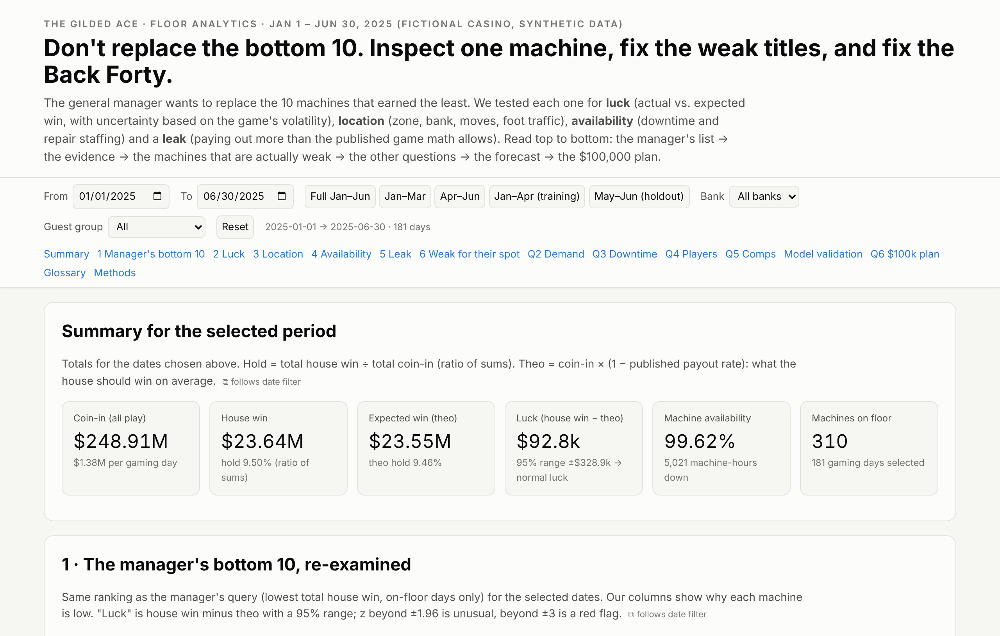
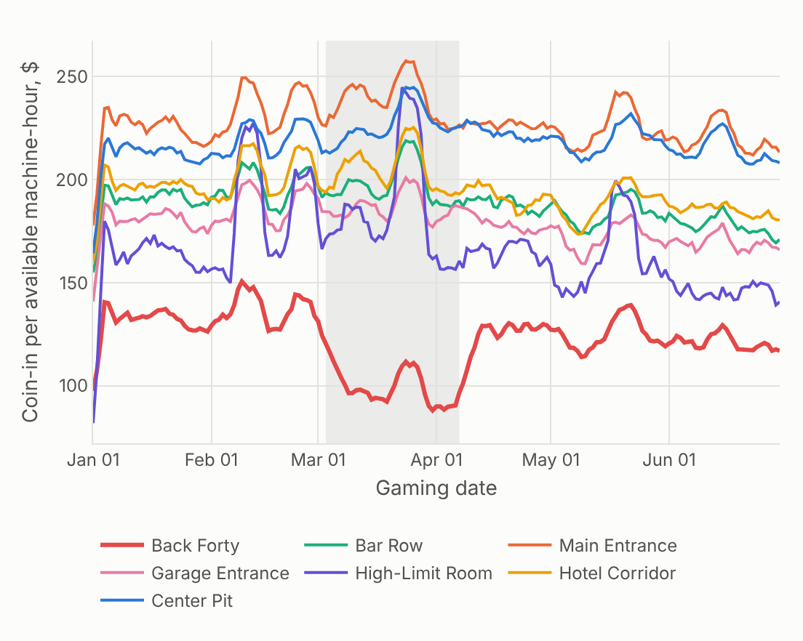
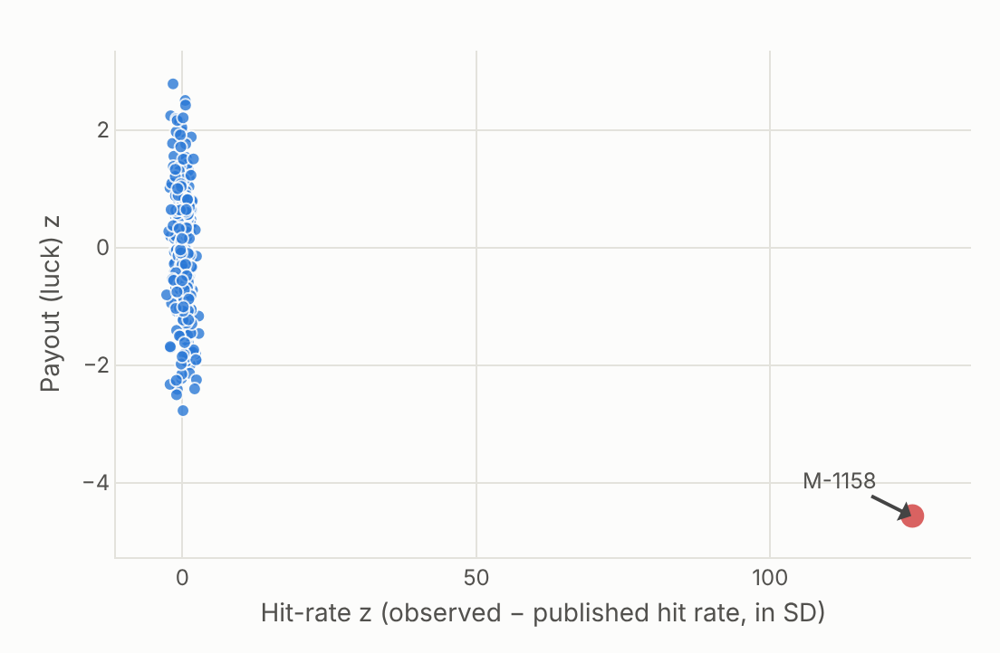
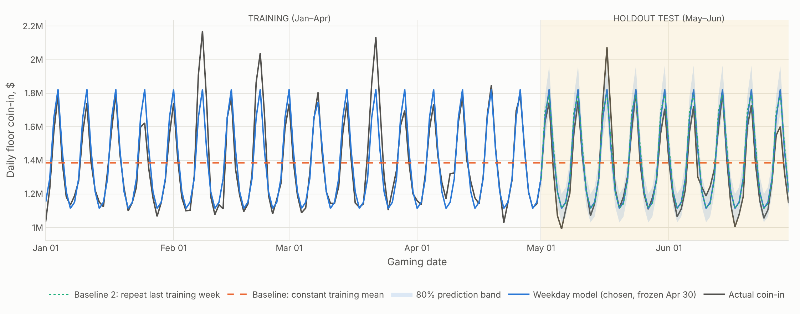

# Casino Floor Analysis

My project for the **TAMU Datathon 2026** "Dashboard Royale" challenge: an interactive dashboard and analysis of six months of slot machine data from a fictional casino.



## The problem

The casino's general manager wants to replace the 10 machines that earned the least between January and June 2025. Before spending money on that, the challenge asked a simple question: **were those machines unlucky, badly placed, or actually broken?**

The dataset covers 310 machines, about $249M in wagers, hourly meters, downtime tickets, player sessions and comps. All of it is synthetic.

## What I found

**Don't replace the bottom 10.** Nine of them sit in the same quiet corner of the floor (the "Back Forty"). Testing each machine separately:

| | Finding |
|---|---|
| **Luck** | Measured house win against expected win, with a standard deviation computed from each game's payout variance. 24 of 310 machines fall outside ±1.96 SD (about 16 expected by chance), and 8 of the bottom 10 are within normal luck. |
| **Location** | For the same game title, a Back Forty machine earns 43% less per available hour than one in the center of the floor. One machine that was moved out of the Back Forty doubled its play per hour (+106%, CI 82–136%). |
| **Leak** | One machine, M-1158, fails two independent tests: it pays on 38.6% of spins against a published 31.5%, and holds 3.0% against an expected 10%. That's an estimated $36k shortfall (95% CI $21k–52k). |
| **Availability** | Downtime was 0.38% of hours. The bottom 10 were up 99.7% of the time, so it isn't the cause. |

The machines that really are weak are 41 units across three loose, low-margin game titles. Those games perform the same way in good and bad zones (r = 0.97), so they can be moved around instead of replaced.

<table>
  <tr>
    <td width="50%"><br><sub>Play per machine-hour by zone. The red line is the Back Forty; the shaded band is a walkway closure that cut its traffic by another 31%.</sub></td>
    <td width="50%"><br><sub>Every machine on two independent leak tests. One sits far outside the rest.</sub></td>
  </tr>
</table>

## Forecast

The challenge also asked for a model validated on held-out data. I trained a weekday forecast of daily floor revenue on January–April and froze it before looking at May–June.

- **MAE $69k/day**, vs. $218k for the constant-mean baseline
- Roughly tied with a "repeat last week" baseline ($72k), which I report rather than hide
- 82% of holdout days land inside the 80% prediction band

It's used to shift staff hours toward Friday and Saturday and to judge whether a promotion actually moved revenue.



## Recommendation

The challenge gave a $100k budget. The plan spends $28,200 and keeps the rest:

1. **Inspect** the two flagged machines: $2,400
2. **Swap** three high-performing machines out of the Back Forty with weak-title machines from the center of the floor: $10,800 (pays back by July, with nine more swaps queued)
3. **Run one tournament weekend** in July, based on the measured +18% lift from the last one: $15,000

## Running it

The dashboard is a single self-contained HTML file with all data embedded. Download [`dashboard.html`](dashboard.html) and open it in a browser. It works offline.

To rebuild everything from the raw data:

```bash
git clone --depth 1 https://github.com/tamu-datathon-org/dashboard-royale.git raw
python3 -m venv .venv && .venv/bin/pip install pandas pyarrow duckdb plotly statsmodels scikit-learn scipy
.venv/bin/python run_all.py
```

`run_all.py` verifies the dataset, runs each analysis step in order and rebuilds `dashboard.html`. To test the dashboard:

```bash
node tests/test_dashboard.js   # headless browser test of the dashboard (Playwright)
```

## How it's built

- **Analysis:** Python and DuckDB over the raw Parquet files, with statsmodels, SciPy and scikit-learn for the regressions, significance tests and forecast
- **Dashboard:** Plotly and plain JavaScript, built into one offline HTML file with date, bank and player-group filters
- **Testing:** Playwright headless test of the dashboard

```
analysis/     numbered scripts, one per question (01_audit.py … 11_plan.py) + dashboard builder
outputs/      small CSV/JSON results each script produces
tests/        headless browser test
```

A few choices that mattered: ratio-of-sums for every rate (averaging daily hold rates understates it by a quarter point), machine location tracked per day instead of from a static map, and the forecast model picked on an inner validation split before the holdout was touched.

## Notes

The casino, its machines and its players are fictional, and the data is synthetic. I built this with [Claude Code](https://claude.com/claude-code) as the main coding tool. I set the goals, constraints and correctness checks, and reviewed the results.
